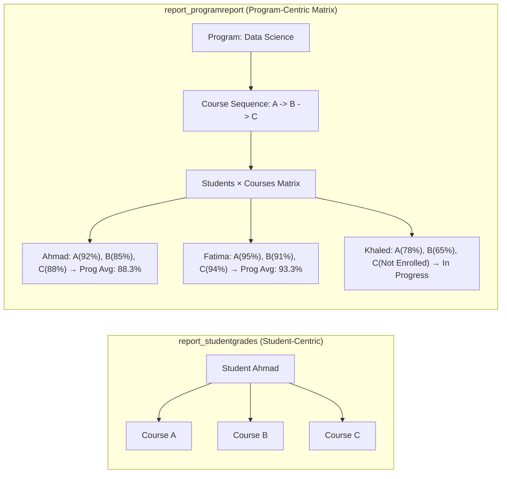
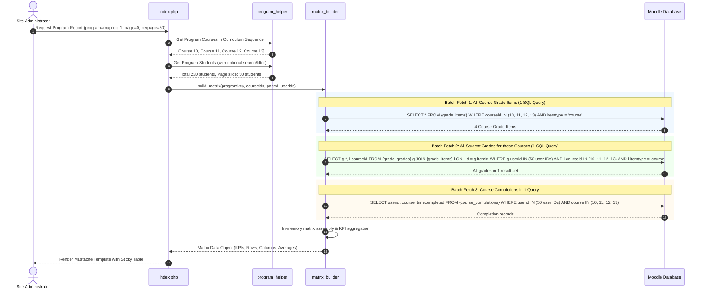
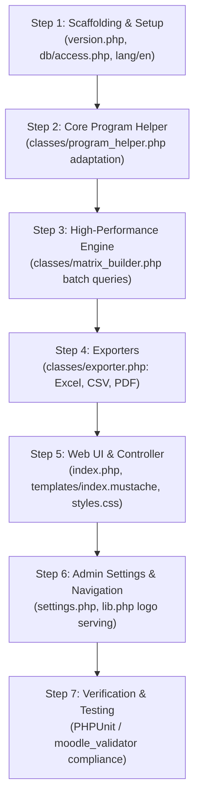

# Architecture & Implementation Plan: `report_programreport`

## 1. Executive Summary & Vision

The **Program Report** plugin (`report_programreport`) provides an executive matrix view for academic programs in Moodle. While [`report_studentgrades`](file:///home/mohammad/Dev/plugins/report/studentgrades) is **student-centric** (one student across all their enrolled courses), `report_programreport` is **program-centric** (one program across all enrolled students and all curriculum courses).



By leveraging proven solutions, error fixes, and performance preloading algorithms already developed in `report_studentgrades`, `report_programreport` avoids reinventing the wheel while delivering scalable, enterprise-grade reporting for site administrators.

---

## 2. Key Architectural Decisions (From /grill-me Alignment)

| Design Dimension | Decision | Rationale |
| :--- | :--- | :--- |
| **Target Directory** | `/home/mohammad/Dev/plugins/report/programreport/` | Clean standalone Git repository. |
| **Component Name** | `report_programreport` | Standard Moodle plugin naming convention. |
| **Primary Layout** | Matrix / Grid Table | Rows = Students, Columns = Courses in sequential order + Summary columns. |
| **Grade Cell Format** | Compact Percentage + Status Badge | Shows percentage with pass/fail/in-progress badge; raw grade and range in tooltip; distinct "Not enrolled" / "-" state. |
| **Program Engine** | Dual Engine Support | Automatically supports both **Open LMS Programs** (`enrol_programs`) and **MuTMS Programs** (`tool_muprog`/`enrol_muprog`). |
| **Audience & Access** | Site Admins Only | Strictly restricted to `is_siteadmin()` or system-level `report/programreport:viewall` to guarantee peer privacy. |
| **Scalability & Paging** | Server-side Pagination | 25, 50, 100, or All per page, with a sticky student column and horizontal scroll. |
| **Aggregates & KPIs** | Top KPI Cards + Bottom Course Stats | Cards for Total Students, Course Count, Completion %, Overall Average; Bottom table rows for Course Average, Pass Rate %, Completion Count. |
| **Exports** | Excel (.xlsx), CSV, Landscape PDF | Matrix export with student identifiers, course grades, summary calculations, and brand styling. |
| **Drill-down Links** | Integrated Navigation | Student name &rarr; `report_studentgrades` (filtered to program); Course header &rarr; Course page; Grade cell &rarr; User course grade report. |
| **Branding & Theme** | Custom Logo & Palette Pickers | Full settings in `settings.php` matching `report_studentgrades` for brand continuity. |
| **Moodle Navigation** | Site Administration &rarr; Reports | Single authoritative entry point in Moodle Admin menu. |

---

## 3. High-Performance Grade Preloading Engine (Solving $N \times M$ Query Bottleneck)

In a program with 200 students and 15 courses, an unoptimized report would execute over **3,000 separate queries** for grade calculation. 

To achieve sub-second page loads, `report_programreport` adapts the batch preloading architecture from [`classes/exporter.php`](file:///home/mohammad/Dev/plugins/report/studentgrades/classes/exporter.php#L3224-L3284):



---

## 4. Complete Plugin File Structure

```
/home/mohammad/Dev/plugins/report/programreport/
├── .git/
├── classes/
│   ├── event/
│   │   └── report_viewed.php          # Standard Moodle event logging
│   ├── external/
│   │   └── search_programs.php        # Optional AJAX search for autocomplete program dropdown
│   ├── privacy/
│   │   └── provider.php               # GDPR compliance (null provider: stores no personal data)
│   ├── exporter.php                   # Excel (.xlsx), CSV, and Landscape PDF generator
│   ├── matrix_builder.php             # Batch SQL preloader, matrix compiler, KPI engine
│   └── program_helper.php             # Dual Open LMS & MuTMS program sequence and user helper
├── db/
│   ├── access.php                     # Capabilities (report/programreport:view, :viewall)
│   └── install.xml                    # Clean (no custom tables needed; purely analytical report)
├── lang/
│   └── en/
│       └── report_programreport.php   # English language strings
├── templates/
│   ├── index.mustache                 # Primary Bootstrap 5 / Boost report template
│   └── matrix_table.mustache          # Sticky-column matrix table partial
├── index.php                          # Main controller, parameter parsing, layout handling
├── lib.php                            # Navigation callbacks and pluginfile logo serving
├── settings.php                       # Site Admin tree registration + branding & color pickers
├── styles.css                         # Sticky columns, responsive table, print/PDF styling
└── version.php                        # Plugin version (Moodle 4.x / 5.x compatible)
```

---

## 5. Technical Specifications of Core Files

### 5.1 `version.php`
```php
<?php
defined('MOODLE_INTERNAL') || die();

$plugin->component = 'report_programreport';
$plugin->version   = 2026111000;
$plugin->requires  = 2022112800; // Moodle 4.1+
$plugin->maturity  = MATURITY_STABLE;
$plugin->release   = 'v1.0.0';
```

### 5.2 `db/access.php`
Strictly limits access to Site Administrators and managers:
```php
<?php
defined('MOODLE_INTERNAL') || die();

$capabilities = [
    'report/programreport:view' => [
        'captype' => 'read',
        'contextlevel' => CONTEXT_SYSTEM,
        'archetypes' => [
            'manager' => CAP_ALLOW,
        ],
    ],
    'report/programreport:viewall' => [
        'captype' => 'read',
        'contextlevel' => CONTEXT_SYSTEM,
        'archetypes' => [
            'manager' => CAP_ALLOW,
        ],
    ],
];
```

### 5.3 `classes/program_helper.php`
Reuses and refines the proven logic from `report_studentgrades`:
- **Detection**: `has_enrol_programs()` and `has_muprog()` using `$DB->get_manager()->table_exists()`.
- **Program List**: `get_accessible_programs()` returns composite keyed programs (`programs_{id}` or `muprog_{id}`).
- **Sequence Preservation**: `get_program_courses(string $programkey)` reads the exact program item sequence tree (`topitem` and `sequencejson`).
- **Enrolled Student Roster**: `get_program_users(string $programkey, string $search = '', string $status = '')` returns student IDs allocated or enrolled via `enrol_programs_allocations` / `tool_muprog_allocation` and `{user_enrolments}`.

### 5.4 `classes/matrix_builder.php`
The core calculation engine:
1. **Roster Filtering & Slicing**:
   - Takes all program user IDs.
   - Applies name/email search if provided.
   - Paginates user IDs: `$pageduserids = array_slice($alluserids, $offset, $perpage)`.
2. **Preloading**:
   - Preloads `course` items from `{grade_items}` for the program courses.
   - Preloads `finalgrade`, `rawgrademin`, `rawgrademax` from `{grade_grades}` in one query.
   - Preloads `{course_completions}` in one query.
3. **Data Matrix Assembly**:
   - For each student row:
     - Student profile info (ID, Fullname, Email, IDNumber).
     - Link to `report_studentgrades`: `new moodle_url('/report/studentgrades/index.php', ['userid' => $uid, 'program' => $programkey])`.
     - Cells for each course:
       - Status: `completed`, `passed`, `failed`, `in_progress`, or `not_enrolled`.
       - Grade formatted: percentage string (e.g., `85.5%`), raw grade string (`85.50 / 100.00`).
       - Pass mark comparison against `$grade_item->gradepass`.
       - Direct link to student course grader: `/grade/report/user/index.php?id={$courseid}&userid={$uid}`.
     - Summary metrics per student:
       - Total required courses.
       - Courses completed count.
       - Program average percentage (weighted or arithmetic mean of completed courses).
       - Program status badge: **Completed** (100%), **In Progress**, or **Not Started**.
4. **Aggregate Statistics (Top KPIs & Bottom Summary)**:
   - Total students enrolled.
   - Total courses in curriculum.
   - Program completion rate (% of students who finished all courses).
   - Overall cohort GPA / average grade.
   - Per-course column summary:
     - Course average score.
     - Course pass rate %.
     - Students completed count.

### 5.5 `classes/exporter.php`
Supports 3 export targets:
1. **Excel Export (`export_excel()`)**:
   - Uses Moodle's `\core\dataformat::download_data` or standard XML/XLSX generator.
   - Formatted header row with branded background color.
   - Columns: Student Name, Email, ID Number, [Course 1 Name], [Course 2 Name], ..., Program Average, Completed Courses, Status.
   - Summary rows at the bottom (Course Averages, Pass Rates).
2. **CSV Export (`export_csv()`)**:
   - High-speed, low-memory output stream via `php://output`.
   - UTF-8 with BOM for Excel compatibility.
3. **Landscape PDF Export (`export_pdf()`)**:
   - Uses Moodle's core `\pdf` (TCPDF).
   - Orientation: `L` (Landscape) with tight cell margins.
   - Custom institution logo rendered in header from stored plugin files.
   - Color-coded cells matching admin settings.

### 5.6 `settings.php`
- Registered under `Site administration -> Reports -> Program Report`:
  ```php
  $ADMIN->add('reports', new admin_externalpage(
      'report_programreport',
      get_string('pluginname', 'report_programreport'),
      new moodle_url('/report/programreport/index.php')
  ));
  ```
- Reuses branding and color pickers:
  - `report_logo` (stored file).
  - `header_primary_color`, `header_secondary_color`.
  - `grade_excellent_color` (default `#28a745`).
  - `grade_good_color` (default `#17a2b8`).
  - `grade_pass_color` (default `#ffc107`).
  - `grade_fail_color` (default `#dc3545`).

---

## 6. UI / UX Design & Interactions

```
+---------------------------------------------------------------------------------------------------------+
| [Logo] PROGRAM REPORT: Data Science Professional Certificate [V Programs Dropdown] [Download Excel/PDF] |
+---------------------------------------------------------------------------------------------------------+
|  KPI CARDS:                                                                                             |
|  [ Total Students: 142 ]   [ Courses: 6 ]   [ Program Completion: 68.4% ]   [ Cohort Average: 84.2% ]   |
+---------------------------------------------------------------------------------------------------------+
|  FILTERS:                                                                                               |
|  Search: [ Type student name... ]  Status: [ All | Completed | In Progress ]  Show: [ 50 per page V ]   |
+---------------------------------------------------------------------------------------------------------+
|  STUDENTS & COURSES MATRIX (Sticky Student Column):                                                     |
|  +--------------------+----------------+----------------+----------------+-------------+-------------+  |
|  | Student Name       | 1. Python 101  | 2. SQL & DBs   | 3. Statistics  | Prog Avg %  | Status      |  |
|  +--------------------+----------------+----------------+----------------+-------------+-------------+  |
|  | Ahmad Al-Mansoor   | 92.0% [Passed] | 88.5% [Passed] | 94.0% [Passed] | 91.5%       | [Completed] |  |
|  | Fatima Zahra       | 95.0% [Passed] | 91.0% [Passed] | In Progress    | 93.0%       | [In Prog]   |  |
|  | Khaled Omar        | 78.0% [Passed] | 54.0% [Failed] | - [Not Enrol]  | 66.0%       | [In Prog]   |  |
|  +--------------------+----------------+----------------+----------------+-------------+-------------+  |
|  | COURSE AVERAGES    | 88.3%          | 77.8%          | 86.5%          | Overall Program Avg: 84.2%  |  |
|  | PASS RATE %        | 96.4%          | 82.1%          | 91.2%          |                             |  |
|  +--------------------+----------------+----------------+----------------+-------------+-------------+  |
|  Pagination: << < [1] 2 3 > >>  (Showing 1-50 of 142 students)                                          |
+---------------------------------------------------------------------------------------------------------+
```

### Key UI Features
- **Sticky First Column**: When scrolling horizontally across 10-20 courses, the student's name and ID remain pinned to the left edge of the viewport.
- **Micro-Interactions**:
  - Hovering over a grade badge reveals a popover tooltip with raw grade (`88.50 / 100.00`), passing mark requirement (`50.00`), and completion timestamp.
  - Clicking a student name navigates directly to `report_studentgrades` for an in-depth breakdown of that student's quizzes, assignments, and AI analytics.
  - Clicking a course column header opens the course homepage in a new tab.

---

## 7. Step-by-Step Implementation Roadmap



### Phase 1: Plugin Foundation (Scaffolding)
- Initialize Git repo in `/home/mohammad/Dev/plugins/report/programreport/`.
- Create `version.php`, `db/access.php` with `report/programreport:viewall`.
- Create `classes/privacy/provider.php` (null provider).
- Write `lang/en/report_programreport.php` with all required strings.

### Phase 2: Program & Data Engine
- Copy and adapt `program_helper.php` from `report_studentgrades` into `classes/program_helper.php`.
- Build `classes/matrix_builder.php` with:
  - Multi-student batch SQL preloading for `grade_items` and `grade_grades`.
  - Course completion status preloader.
  - In-memory calculation for student rows, column stats, and top KPI cards.

### Phase 3: Export Infrastructure
- Implement `classes/exporter.php`:
  - `export_excel()`: Matrix table with column headers, formatted numbers, and summary rows.
  - `export_csv()`: Streamed matrix data.
  - `export_pdf()`: Clean TCPDF landscape table with logo.

### Phase 4: UI & Controller
- Build `index.php`:
  - Enforce `require_login()` and `is_siteadmin()`.
  - Parameter handling (`program`, `page`, `perpage`, `search`, `status`, `action`).
  - User preference persistence (`set_user_preference('report_programreport_lastprogram', $program)`).
- Create `templates/index.mustache`:
  - Program selector dropdown.
  - KPI metric cards.
  - Responsive matrix table with sticky columns.
  - Bootstrap 5 pagination controls.
- Create `styles.css`:
  - CSS sticky column definitions (`position: sticky; left: 0; z-index: 2;`).
  - Responsive horizontal scrolling containers.
  - Performance color badges.

### Phase 5: Admin Integration & Validation
- Build `settings.php`:
  - Register external page under `reports`.
  - Add branding heading, logo file upload, and color pickers.
- Build `lib.php`:
  - Implement `report_programreport_pluginfile()` to securely serve the report logo.
- Code validation:
  - Run Moodle code checker and verify strict adherence to Moodle coding guidelines.
